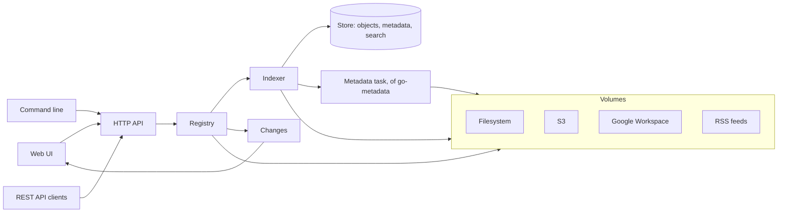

# go-filer

[](https://pkg.go.dev/github.com/mutablelogic/go-filer)
[](https://github.com/mutablelogic/go-filer/actions/workflows/test.yaml)

Filer puts object-oriented data sources behind one file system.

- **Sources:** local file systems, S3 buckets, Google Workspace (Drive, Calendar, Contacts and Tasks) and RSS feeds are each a volume of files and folders.
- **Indexed:** each volume is indexed, and its objects' metadata enriched, such as a photo's camera and place, a song's artist, or a document's title.
- **Search:** search files, tasks, events, and media using rich metadata queries from the index.
- **Interfaces:** a web application, a command line, and a REST API.

## Quick Start

> [!WARNING]
> **Don't run filer on the internet.** It has no authentication yet, so anyone who can reach it can read, and change, your volumes and credentials. Publish its port on `localhost` only, as below, or put it behind a proxy that signs people in, or a VPN.

Run the server, with a directory of yours mounted, such as `/mnt/media`:

```bash
docker volume create filer

docker run -d --name filer -p 127.0.0.1:8084:8084 \
  -v filer:/data -v /mnt/media:/media:ro \
  ghcr.io/mutablelogic/filer
```

Then open [http://localhost:8084/](http://localhost:8084/), choose **Add Volume**, then **Server filesystem**, with the path `/media`, and set **Search** to **Metadata**, so its files are indexed, and their metadata read.

- **Data:** credentials and the index are kept in `/data/filer`, and volumes' caches in `/data/cache`.
- **User:** the server runs as the `filer` user. Set `UID` and `GID`, such as to the owner of the mounted directories, which `/data` is made the owner of.
- **Image:** `ghcr.io/mutablelogic/filer`, for `linux/amd64` and `linux/arm64`, is published with each release, built with cgo, so it reads the metadata of audio, video and photos.

For the command line:

```bash
CGO_ENABLED=0 go install -tags client github.com/mutablelogic/go-filer/cmd/filer@latest
filer volume-create-fs media /media -o index=metadata
filer volumes
filer search beethoven
```

It talks to `localhost:8084`, or `FILER_ADDR`. Inside the container, `docker exec filer filer volumes` does the same.

## Adding Google Workspace

Google Drive, Calendar, Contacts and Tasks are volumes too, which sign in with Google, as you, once you've an OAuth client of your own:

1. **Create a project** in the [Google Cloud console](https://console.cloud.google.com/), and enable the APIs of the volumes you want: the Drive API, the Google Calendar API, the People API (Contacts) and the Google Tasks API.
2. **Set up the consent screen** (Google Auth Platform), as an external app in testing, with yourself as a test user.
3. **Create an OAuth client**, of the type **Web application**, whose authorized redirect URIs are:
   - `http://localhost:8084/api/credential-signin/callback`, of the web UI, or `https://<host>/api/credential-signin/callback`, as it's reached (Google only allows `http` of `localhost`);
   - `http://localhost:8085/callback`, of the command line.

   Download its JSON.
4. **Store it** as the server's `GOOGLE_CLIENT` credential:

   ```bash
   docker exec -i filer filer credential-set GOOGLE_CLIENT --json < client_secret.json
   ```

5. **Add a volume**, with **Add Volume**, such as **Google Drive**, and **Sign in with Google**, in the window which opens. Or, with the command line, `filer volume-create-gdrive drive`, which signs in, in the browser.

One sign-in, `GOOGLE_TOKEN`, is shared by the Google volumes, and asks for each one's access as it's added. See [Google](docs/backends.md#google) for each volume's layout, options and writing.

## Architecture



- **[Backends](docs/backends.md):** each source, of a URL's scheme, such as `file`, `s3`, `gdrive` or `rss`: its layout, options, writing and watching.
- **[Architecture](docs/architecture.md):** the registry of volumes, the indexer and its store, metadata enrichment and search, the volumes' caches, actions, and watching changes.
- **[Development](docs/development.md):** the Go packages, building with go-media's libraries, testing, using them as a library, the object model, and errors.
- **[Web UI](frontend/README.md):** the frontend, which the server embeds.

## Roadmap

TODO: milestones of these themes, from the [issue list](https://github.com/mutablelogic/go-filer/issues):

- **File browser:** upload and delete ([#216](https://github.com/mutablelogic/go-filer/issues/216)), sorting ([#218](https://github.com/mutablelogic/go-filer/issues/218)), more of a preview ([#219](https://github.com/mutablelogic/go-filer/issues/219)), and its packages ([#148](https://github.com/mutablelogic/go-filer/issues/148), [#149](https://github.com/mutablelogic/go-filer/issues/149), [#220](https://github.com/mutablelogic/go-filer/issues/220)).
- **Indexing:** failed files ([#217](https://github.com/mutablelogic/go-filer/issues/217)), artwork ([#146](https://github.com/mutablelogic/go-filer/issues/146)) and content ([#147](https://github.com/mutablelogic/go-filer/issues/147)).
- **Search:** its UI ([#150](https://github.com/mutablelogic/go-filer/issues/150)), filters, places and events ([#138](https://github.com/mutablelogic/go-filer/issues/138)–[#142](https://github.com/mutablelogic/go-filer/issues/142)), and saved searches ([#151](https://github.com/mutablelogic/go-filer/issues/151)).
- **Backends:** Gmail ([#144](https://github.com/mutablelogic/go-filer/issues/144)), MCP servers ([#145](https://github.com/mutablelogic/go-filer/issues/145)), Drive's moves ([#174](https://github.com/mutablelogic/go-filer/issues/174)), and a Postgres store ([#72](https://github.com/mutablelogic/go-filer/issues/72)).
- **Authentication,** so it can be run beyond localhost.

## License

go-filer is licensed under the [Apache License, Version 2.0](LICENSE).
